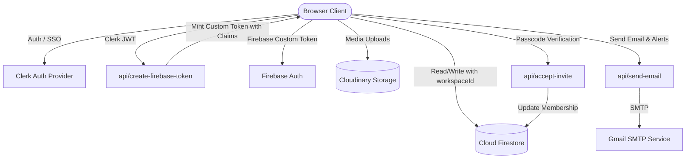

# System Architecture & Technical Design
## Invomora — Multi-Tenant B2B Invoicing SaaS

---

## 1. High-Level Architecture Overview

Invomora utilizes a hybrid architecture combining client-side rendering with Clerk Auth, Firebase Cloud Firestore, Cloudinary media storage, and serverless edge functions on Vercel:



---

## 2. Authentication & Tenancy Model

### 2.1 The Clerk-to-Firebase Bridge
1. User logs in via Clerk (`/login` or `/register`).
2. Client gets Clerk JWT template: `session.getToken({ template: "firebase" })`.
3. Client posts the token to `/api/create-firebase-token.js`.
4. The serverless function verifies the Clerk token via `@clerk/backend`, checks the user's active workspace and role in `workspace_members`, and mints a Firebase custom token with `{ workspaceId, role }` claims.
5. Client completes `signInWithCustomToken(auth, customToken)`. All subsequent Firestore requests carry `request.auth.uid` and `request.auth.token.workspaceId`.

### 2.2 Double Security on Workspace Operations
- **Invite Dispatch:** The workspace owner must enter the 6-digit workspace PIN (`invitePasscode`) to authorize inviting a member.
- **Invite Acceptance:** The recipient must enter the same 6-digit PIN to accept the invite via `/api/accept-invite.js`.
- **Inactivity Standby Lock:** Screen locks after 15 minutes of inactivity; 3 failed PIN attempts trigger immediate email notifications to the owner and log an alert in `activity_logs`.

---

## 3. Database Schema (Cloud Firestore)

Tenancy is partitioned by `workspaceId`:

### 3.1 `workspaces` Collection
```typescript
interface Workspace {
  id: string;               // Auto-generated Firestore ID
  name: string;             // e.g. "Acme Corp"
  ownerId: string;          // Clerk user ID of creator
  invitePasscode: string;   // 6-digit numeric PIN
  createdAt: Timestamp;
  updatedAt: Timestamp;
}
```

### 3.2 `workspace_members` Collection
- **Document ID:** `${workspaceId}_${userId}`
```typescript
interface WorkspaceMember {
  workspaceId: string;
  userId: string;
  email: string;
  displayName: string;
  role: "owner" | "accountant";
  joinedAt: Timestamp;
}
```

### 3.3 `workspace_invites` Collection
```typescript
interface WorkspaceInvite {
  id: string;
  workspaceId: string;
  workspaceName: string;
  invitedEmail: string;
  role: "owner" | "accountant";
  invitedBy: string;
  status: "pending" | "accepted" | "revoked";
  createdAt: Timestamp;
}
```

### 3.4 `invoices` Collection
```typescript
interface Invoice {
  id: string;
  workspaceId: string;
  userId: string;              // Creator UID
  invoiceNumber: string;       // e.g. "INV-001"
  invoice_no: string;          // Legacy compatibility
  invoiceDate: string;         // YYYY-MM-DD (up to 90 days backdated)
  customer: {
    id: string;
    name: string;
    email: string;
    gstin?: string;
    address?: string;
  };
  items: Array<{
    id: string;
    title: string;
    quantity: number;
    price: number;
    taxRate: number;           // e.g. 18
  }>;
  subTotal: number;
  taxAmount: number;
  total: number;
  status: "Draft" | "Pending" | "Paid" | "Overdue";
  paymentType?: "UPI" | "Card" | "Cash";
  createdAt: Timestamp;
}
```

### 3.5 `counters` Subcollection
- **Document Path:** `workspaces/{workspaceId}/counters/invoice`
```typescript
interface InvoiceCounter {
  current: number;             // Atomically incremented via runTransaction
  lastInvoiceNumber: string;   // e.g. "INV-042"
  updatedAt: Timestamp;
}
```

### 3.6 `activity_logs` Collection
```typescript
interface ActivityLog {
  id: string;
  workspaceId: string;
  actorUid: string;
  actorName: string;
  actorEmail: string;
  action: string;              // e.g. "invoice_create", "security_alert", "member_invite"
  entityType: string;          // "invoice", "customer", "product", "workspace", "security"
  entityId: string;
  entityTitle: string;
  details: string;
  createdAt: Timestamp;
}
```

---

## 4. Frontend Component Hierarchy & State

```
App.jsx (Shell & Router)
 ├── AuthProvider (Clerk Auth Context)
 ├── WorkspaceProvider (Active Workspace & Team Context)
 │    ├── InactivityLock (Standby screen overlay)
 │    ├── Header (Navbar & Profile Switcher)
 │    │    ├── WorkspaceSwitcher
 │    │    ├── InvitationsModal
 │    │    └── ProfileModal
 │    └── Pages (Protected by ProtectedRoute)
 │         ├── Home (Analytics & Recent Invoices)
 │         ├── Invoice (Invoice List & ActionMenu)
 │         │    ├── AddInvoice (Creation Form & Tax Math)
 │         │    ├── UpdateInvoice (Edit Form)
 │         │    └── ViewInvoice (PDF Preview & Download)
 │         ├── Customer (Customer Directory)
 │         ├── Products (Product Catalog)
 │         ├── BusinessProfile (Workspace Branding & Bank Info)
 │         └── ActivityLog (Real-time Audit Ledger)
```

---

## 5. Security Rules Architecture

- **Domain Rules (`invoices`, `customers`, `products`):**
  - Access granted if `request.auth.token.workspaceId == resource.data.workspaceId` or user is a member of `workspace_members`.
  - Deletions are restricted to workspace managers (`owner`) or the original creator.
- **Activity Logs:** Members can read and create audit entries; update and delete are strictly disabled (`allow update, delete: if false`).
- **Sequential Counters:** Enforced via server-side atomic transactions.
