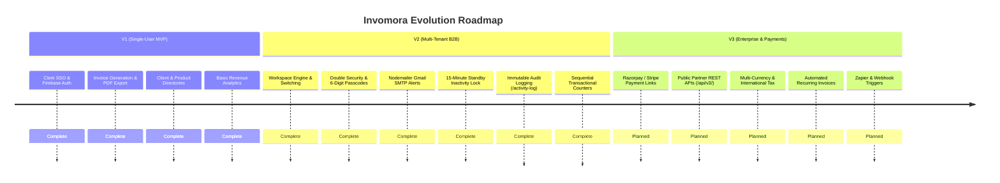

# Product Roadmap & Version Milestones
## Invomora — Invoicing & Financial Operations SaaS

---

## 1. Version Overview & Trajectory

---

## 2. Version 1: Single-User MVP (Completed)
- **Core Engine:** Basic React 19 + Vite + Tailwind CSS v4 setup.
- **Authentication:** Clerk Auth with Google Sign-in and Email/Passwordless login.
- **Storage:** Cloudinary unsigned preset for business logo and signature uploads.
- **Invoice Creation:** Dynamic line item additions, tax calculations, and `@react-pdf/renderer` PDF download.
- **Client & Product Directory:** Basic CRUD collections keyed by `userId`.

---

## 3. Version 2: Multi-Tenant B2B SaaS (Current Release)
- **Multi-Tenant Architecture:** Introduced `workspaces`, `workspace_members`, and `workspace_invites`.
- **Role-Based Access Control:** `owner` (full workspace management) and `accountant` (billing operations).
- **Double Security:**
  - Workspace owner must authenticate with 6-digit PIN before issuing team invitations.
  - Recipient must verify the 6-digit PIN to join the workspace.
- **Automated Email Service:**
  - Serverless Nodemailer with Gmail SMTP.
  - Branded invitation emails with passcodes.
  - Immediate security alert emails on failed passcode attempts.
- **Standby & Inactivity Lock:**
  - 15-minute idle detection auto-locks the screen with a full-screen blur backdrop.
  - 3 failed unlock attempts dispatch security alert emails.
  - Manual "Lock Screen" action in top navigation profile dropdown.
- **Compliance & Audit Ledger:**
  - Real-time immutable audit trail at `/activity-log`.
  - Scoped transactional counters preventing sequential numbering gaps.

---

## 4. Version 3: Enterprise & Automation (Upcoming Phase)

### 4.1 Payment Gateway Integration
- **Direct UPI & Card Payments:** Integrate Razorpay & Stripe to generate dynamic payment links attached to invoices.
- **Webhook Handlers:** `/api/v3/webhooks/razorpay` to auto-reconcile invoice status from `Pending` to `Paid`.

### 4.2 Public & Partner REST APIs (`/api/v3/`)
- Public API keys scoped per workspace.
- Endpoints for external accounting software (Tally, Zoho, QuickBooks) and Zapier automation:
  - `POST /api/v3/invoices`
  - `GET /api/v3/invoices/:id`
  - `POST /api/v3/customers`

### 4.3 Recurring Subscriptions & Multi-Currency
- Auto-generate recurring monthly/yearly invoices on schedule.
- Multi-currency support (USD, EUR, GBP, AED) with real-time exchange rates.
- Automatic email payment reminders 3 days before due date.
